<div align="center">

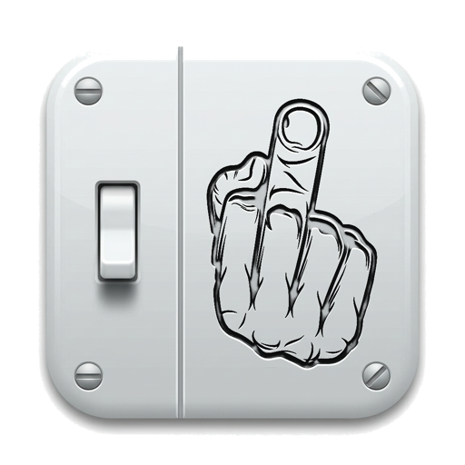

<h1>MacTweak</h1>

<b>Your windows, your corners, your buttons.</b>

Corner radius, traffic-light themes, borders, outlines and shadows for every app on macOS — from a settings window that looks like the old System Preferences.

<p>


</p>

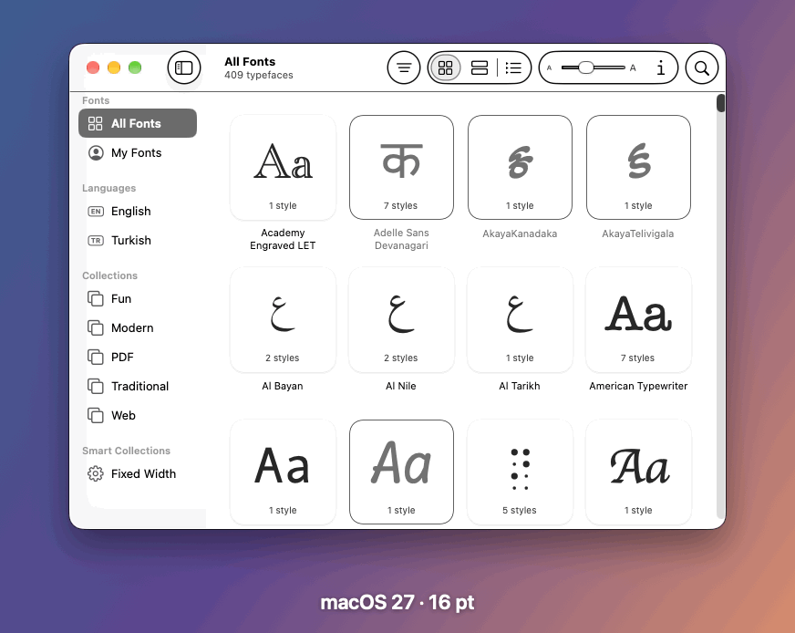
<br><sub>One open window, five corner styles, changed live. No relaunch.</sub>

<br><br>

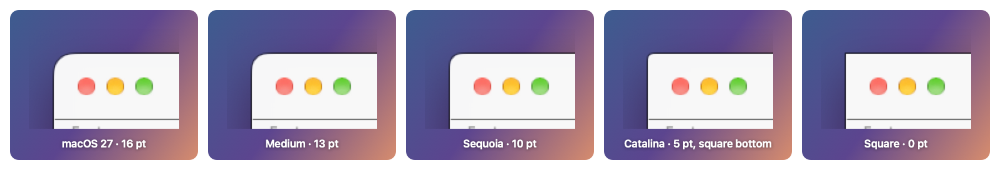

<h3><a href="https://github.com/hakanuzum/mactweak/releases/latest">Download</a> · <a href="#install">Install</a> · <a href="#is-it-safe">Is it safe?</a></h3>

<sub>⚠️ MacTweak needs System Integrity Protection turned off. Read <a href="#install">Install</a> before you download.</sub>

</div>

---

<table width="100%">
<tbody>
<tr valign="top">
<td width="50%">
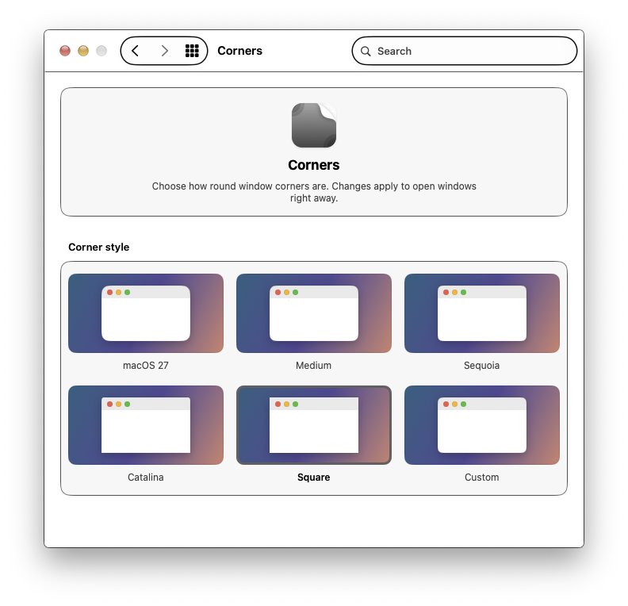
<h3>Corners</h3>
<p>Pick a radius for every window: macOS 27's 16 pt, Medium (13 pt), Sequoia (10 pt), Catalina (5 pt on top, square at the bottom), Square, or your own top and bottom values.</p>
<p>Open windows change right away. Give a single app its own radius in <b>App Rules</b>.</p>
</td>
<td width="50%">
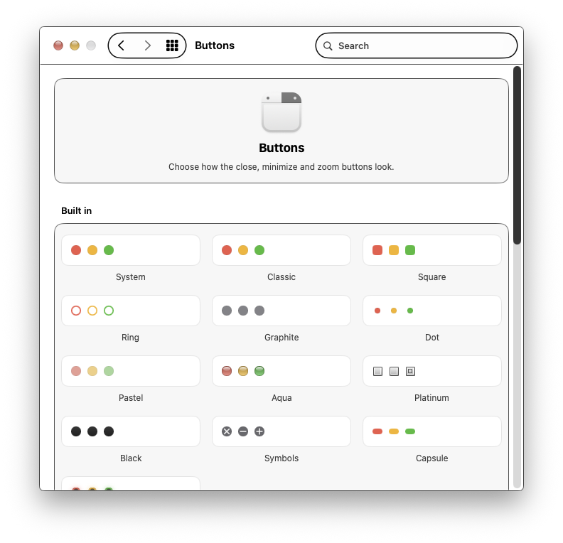
<h3>31 button themes</h3>
<p>Close, minimize and zoom, redrawn: 13 built-in styles (Classic, Aqua, Platinum, Ring, Capsule, Neon, Symbols…) and 18 sets taken from the most downloaded KDE and GTK window decorations.</p>
<p>Buttons can keep their color in background windows, so you always know where close is.</p>
</td>
</tr>
<tr valign="top">
<td width="50%">
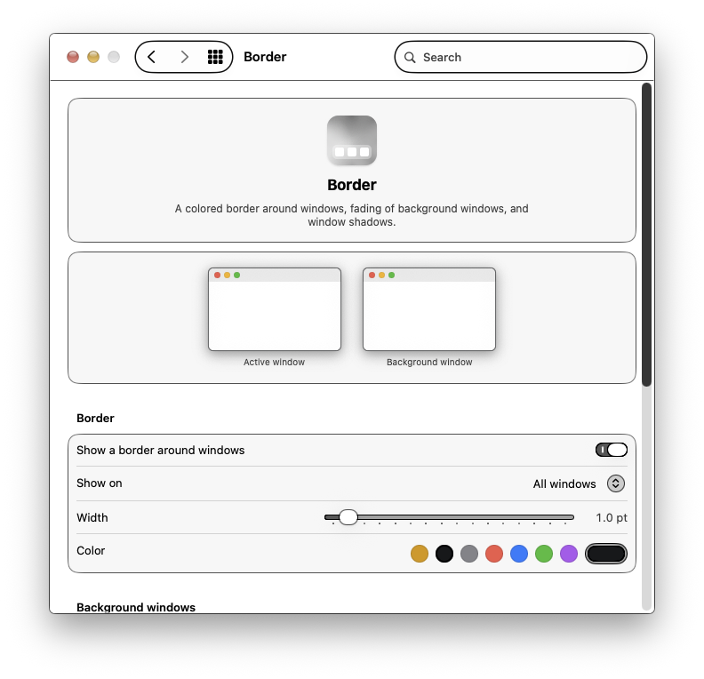
<h3>Border, fading and outline</h3>
<p>A colored border around the active window, or all of them: width from 0.5 to 8 pt, any color. Background windows can fade to 40%.</p>
<p>macOS's own thin window outline is adjustable too — the dark line outside and the light line inside — as are the shadow's strength and size.</p>
</td>
<td width="50%">
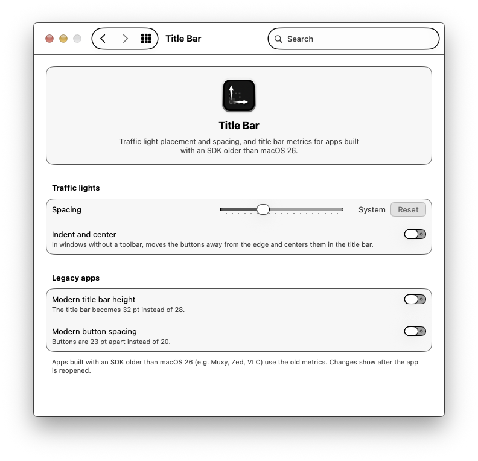
<h3>Title bar</h3>
<p>Move the traffic lights closer together or further apart, or indent and center them in windows without a toolbar.</p>
<p>Apps built for older macOS versions can get the macOS 26 title bar height and button spacing, so they stop looking out of place.</p>
</td>
</tr>
</tbody>
</table>

---

<div align="center">
<h3>All together</h3>
<table>
<tr>
<td align="center">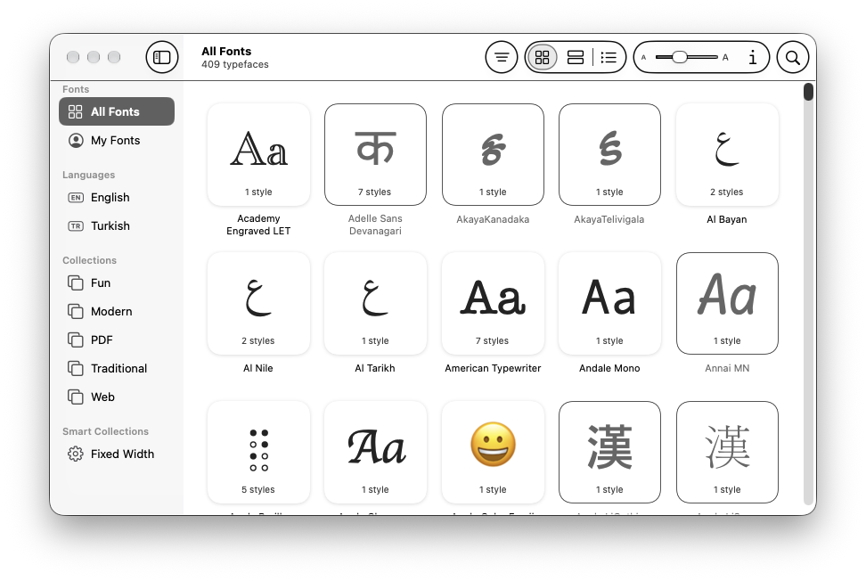<br><sub>macOS 27 as it ships (Graphite accent)</sub></td>
<td align="center">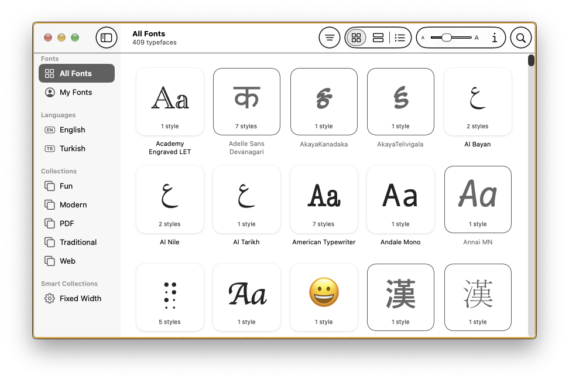<br><sub>With MacTweak: 6 pt corners, Aqua buttons, a gold border on the active window</sub></td>
</tr>
</table>
</div>

---

<div align="center">
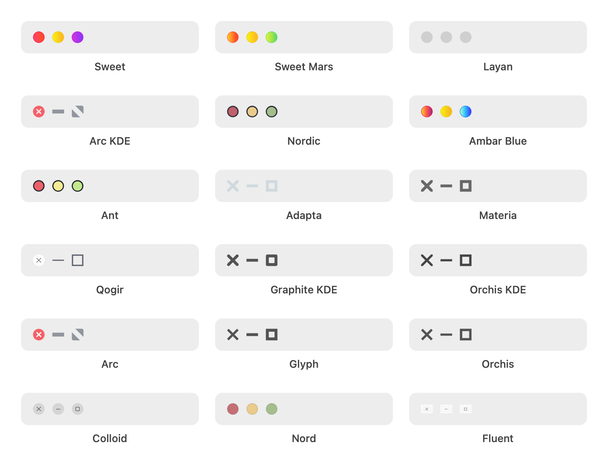
<br><sub>The open-source sets. The KDE ones are in order of their KDE Store downloads; Sweet alone has 1.4 million.</sub>
</div>

---

<div align="center">
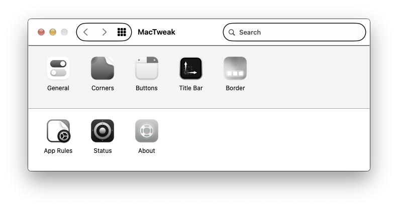
</div>

Everything lives in one window laid out like the System Preferences of the early 2000s: General, Corners, Buttons, Title Bar, Border, App Rules, and a Status page that shows which open apps are using MacTweak and which need a relaunch.

## Install

MacTweak works by loading a small library into the apps you open and changing how they draw their windows. macOS does not allow that out of the box, so two protections have to be turned off, once per Mac. **This lowers your Mac's security**; read [Is it safe?](#is-it-safe) first.

**1. Turn off System Integrity Protection**

1. Shut down. Press and hold the power button until you see *Loading startup options*.
2. Choose **Options**, then **Utilities → Terminal**, and run:
   ```bash
   csrutil disable
   ```
3. Confirm, enter your password and restart.

**2. Let AMFI load the library**

Back in macOS, in Terminal:

```bash
sudo nvram boot-args="amfi_get_out_of_my_way=1"
```

Check the spelling with `nvram boot-args` (a typo is silently ignored), then restart.

**3. Install the app**

Download the latest `.dmg` from [Releases](https://github.com/hakanuzum/mactweak/releases/latest) and drag MacTweak onto Applications. It is signed ad hoc, not notarized, so the first time, right-click it in `/Applications` and choose **Open**.

In **General**, press **Start**. MacTweak loads into the apps you open from then on; the **Status** page lists the ones still running without it, each with a **Relaunch** button.

If SIP or AMFI is still on, MacTweak stays out of every app: it never half-works on a Mac where it cannot work.

### Uninstall

1. In **General**, turn off **Start at login**. Open windows return to the macOS defaults.
2. Delete MacTweak from Applications.
3. Turn the protections back on: `sudo nvram -d boot-args` in macOS, then `csrutil enable` in the Recovery Terminal.

## Is it safe?

Turning off SIP and AMFI is a real trade-off. With them off, other software could load code into apps the same way MacTweak does. Only do it on a Mac you control, and turn them back on if you stop using MacTweak.

What MacTweak itself does and does not do:

- No root, no admin password, no kernel extension. It runs as your user.
- It only acts inside apps (`.app` bundles). Command-line tools get the library, but it stays idle in them.
- It never touches the login window, password and Touch ID prompts, the screen saver, the Dock or Window Manager.
- If an app crashes inside MacTweak, the agent sees the crash report and turns MacTweak off for that app. You can see and undo this in **App Rules**.
- Settings reach apps through Darwin notifications. MacTweak sends nothing over the network.

## How it works

| Part | What it does |
|---|---|
| `core/` → `libmactweak.dylib` | Loaded into each app through `DYLD_INSERT_LIBRARIES`. Links no frameworks; reaches AppKit through the Objective-C runtime and hooks the private methods that draw window corners, title bars and the close, minimize and zoom buttons. |
| `agent/` → `mactweak-agent` | A user LaunchAgent. Turns your preferences into notification state that every app can read (sandboxed ones too), adds the library to the launchd environment and watches for crash reports. |
| `app/` → `MacTweak.app` | The SwiftUI settings window. |

The hooks, the measurements behind them and how to add a module are in [docs/DEVELOPMENT.md](docs/DEVELOPMENT.md).

## Build from source

Needs Xcode 26 or later.

```bash
./build.sh            # build/MacTweak.app
./build.sh --install  # copy to /Applications and restart the agent
./build.sh --dmg      # dist/MacTweak-<version>.dmg
```

## Credits

The button sets come from open-source desktop themes: [Sweet](https://github.com/EliverLara/Sweet), [Nordic](https://github.com/EliverLara/Nordic) and [Ant](https://github.com/EliverLara/Ant) by Eliver Lara; [Layan](https://github.com/vinceliuice/Layan-kde), [Qogir](https://github.com/vinceliuice/Qogir-kde), [Graphite](https://github.com/vinceliuice/Graphite-kde-theme), [Orchis](https://github.com/vinceliuice/Orchis-kde), [Colloid](https://github.com/vinceliuice/Colloid-gtk-theme), [Fluent](https://github.com/vinceliuice/Fluent-gtk-theme) and [WhiteSur](https://github.com/vinceliuice/WhiteSur-gtk-theme) by Vince Liuice; [Arc](https://github.com/jnsh/arc-theme); and [Arc KDE](https://github.com/PapirusDevelopmentTeam/arc-kde), [Adapta KDE](https://github.com/PapirusDevelopmentTeam/adapta-kde) and [Materia KDE](https://github.com/PapirusDevelopmentTeam/materia-kde) by the Papirus team. The pane icons are from the [WhiteSur icon theme](https://github.com/vinceliuice/WhiteSur-icon-theme), and the hand in the app icon is [Fluent Emoji](https://github.com/microsoft/fluentui-emoji). Each set's source and license: [assets/button-themes/SOURCES.md](assets/button-themes/SOURCES.md).

## License

[GPL-3.0](LICENSE), like most of the artwork it ships with. Fluent Emoji and the WhiteSur GTK theme are MIT.

MacTweak is not affiliated with Apple. macOS is a trademark of Apple Inc.
